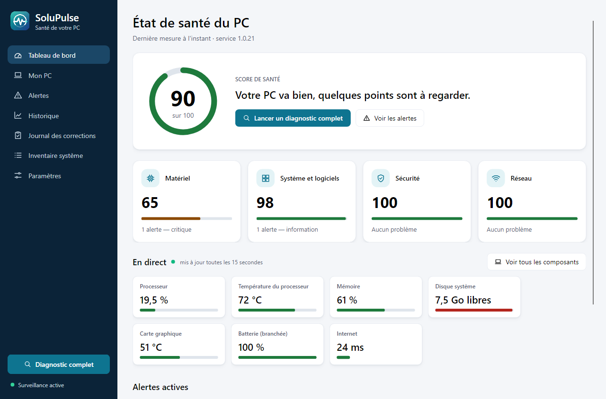
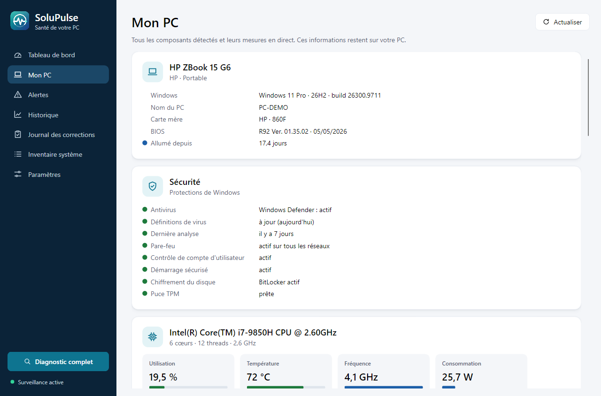
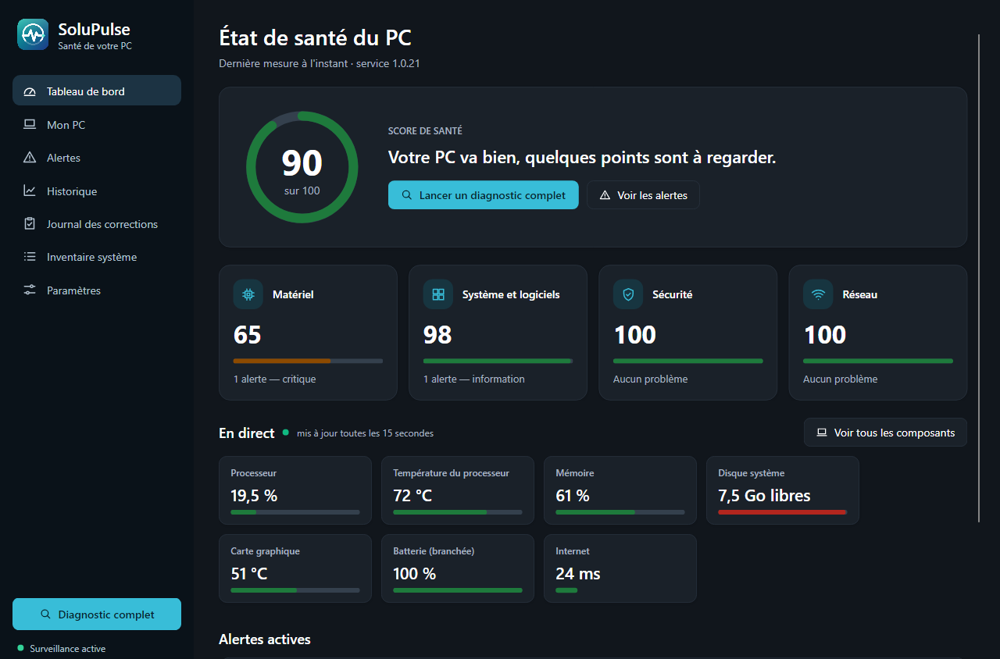

<p align="center"></p>

# SoluPulse

*[Version française](README.md)*

SoluPulse is a free, open source (GPL-3.0) health monitor for Windows PCs, developed for Solutech. A Windows service watches the hardware, the system, the network and the security settings around the clock. When something goes wrong, the desktop app explains it in plain language and proposes a fix; nothing runs until the user approves it. All data stays on the PC.

The user interface and the explanations are in French; English is planned for a later version.

<p align="center"></p>

| My PC page | Dark theme |
| --- | --- |
|  |  |

## Features

- **Continuous monitoring**: CPU (load, temperature, clock, power), memory and each module, graphics cards, motherboard sensors and fans, disks (free space, temperature, SSD wear, SMART), battery, network (gateway, Internet, DNS, Wi-Fi, throughput), system (blue screens, crashes, failed services, startup programs, pending updates) and security (antivirus, firewall, UAC, Secure Boot, BitLocker, TPM).
- **41 detection rules** across hardware, system, network and security, each with a plain-language explanation, a probable cause and a technical explanation.
- **21 fixes the user approves** (cleanup, Windows repair tools, network resets, firewall, Defender update and scan), 6 of them reversible, with a restore point before medium-risk system changes and a check afterwards that the problem is gone. **8 step-by-step guides** for what the user does themselves.
- **Desktop app**: health score out of 100, live values, a page listing every component, alert history, charts over 24 hours to a year, a journal of fixes with an Undo button, Windows notifications and a tray icon colored by PC health. Light and dark themes.

Full list (French): [docs/fonctionnalites.md](docs/fonctionnalites.md).

## Security and privacy

- **Nothing runs without approval**: fixes need a single-use token issued when the user sees the fix card, bound to that Windows user and valid for 10 minutes.
- **Closed catalog**: the service only runs the fixes compiled into it, with parameters picked from lists it provides; Windows tools are called with fixed arguments, never through a shell.
- **Local only**: the app talks to the service over a local named pipe protected by an ACL; no network port is opened, and only the installed SoluPulse app is accepted as a client.
- **Tamper-evident audit log** chained with SHA-256.
- **No data leaves the PC**; no serial numbers, MAC addresses or file contents are collected. See [docs/donnees-collectees.md](docs/donnees-collectees.md).
- **No vulnerable driver**: sensors are read through PawnIO, never WinRing0.

## Download

Installers are published on the [releases page](https://github.com/Nissi-Deh/SoluPulse/releases): download `SoluPulse-Setup-<version>.exe` and run it. Requires Windows 10 22H2 or Windows 11, 64-bit.

## Code signing

Free code signing provided by [SignPath.io](https://signpath.io), certificate by [SignPath Foundation](https://signpath.org). Installers are built by GitHub Actions from this repository and each signing request is approved manually by the maintainer. See the [code signing policy](docs/politique-signature.md) (French). Until signing is active, Windows shows "Unknown publisher": click **More info**, then **Run anyway**.

## Building

Requirements: Windows 10 22H2 or 11 x64, .NET 10 SDK.

```powershell
dotnet build SoluPulse.sln
dotnet test SoluPulse.sln
./build/build-installer.ps1 -Version 1.0.0
```

Architecture, development setup and installer details are described in the [French README](README.md).

## License

SoluPulse is free software by Solutech, released under the [GNU GPL version 3 or later](LICENSE). Third-party components keep their own licenses ([installer/licences](installer/licences)). To report a vulnerability, see [SECURITY.md](SECURITY.md).
