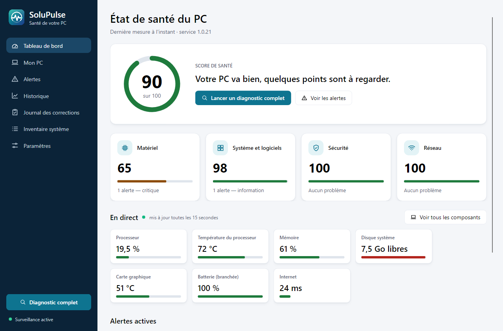
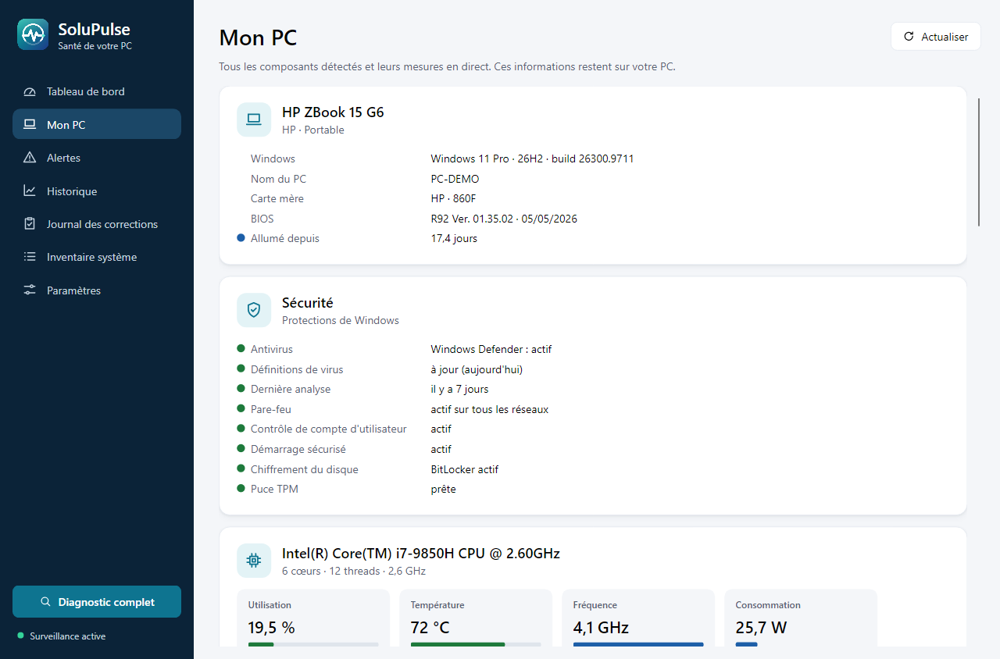
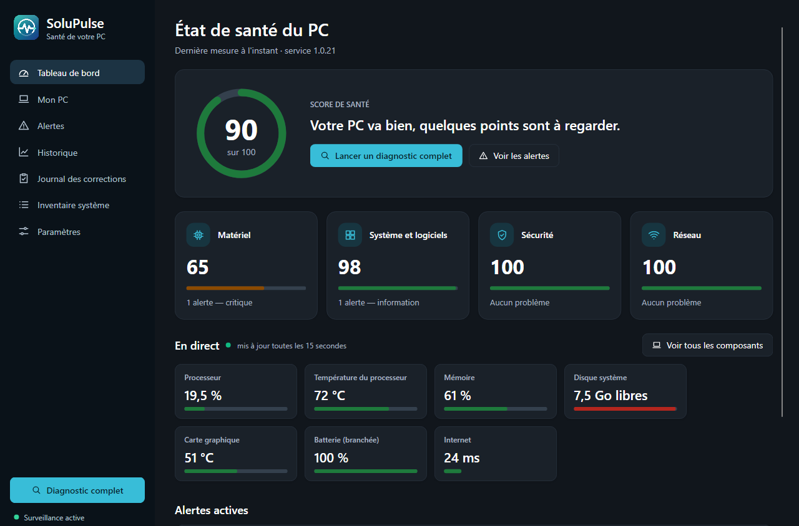

<p align="center"></p>

# SoluPulse

*[English version](README.en.md)*

Agent Windows qui surveille le PC en continu, explique les problèmes en français simple et propose des corrections que l'utilisateur valide. Projet Solutech. Les références du type EF-COR-01 ou ENF-SEC-04 renvoient aux exigences du cahier des charges interne.

Ce dépôt contient la **V1** : service Windows, application de bureau, diagnostic local, alertes, corrections réversibles et installeur MSI. La liste complète est dans [docs/fonctionnalites.md](docs/fonctionnalites.md).

<p align="center"></p>

| Mon PC | Thème sombre |
| --- | --- |
|  |  |

## Téléchargement

L'installeur de chaque version est publié sur la page des [versions](https://github.com/Nissi-Deh/SoluPulse/releases) : téléchargez `SoluPulse-Setup-<version>.exe` et lancez-le. Windows 10 22H2 ou Windows 11, 64 bits.

Les installeurs sont signés gratuitement par [SignPath Foundation](https://signpath.org) ([politique de signature](docs/politique-signature.md)). Tant que la signature n'est pas active, Windows affiche « Éditeur inconnu » : cliquez sur **Informations complémentaires**, puis **Exécuter quand même**.

## Architecture

Deux processus séparés sur le PC (cahier des charges §5) :

```
┌──────────────────────────────┐   gRPC sur canal nommé local   ┌───────────────────────────────────┐
│ SoluPulse.Desktop            │   protégé par ACL, appelant     │ SoluPulse.Agent (service, SYSTEM) │
│ session de l'utilisateur,    │ ◄─────────────────────────────► │ collecteurs → SQLite → règles     │
│ sans droits administrateur   │   authentifié                   │ → alertes ; exécuteur d'actions   │
└──────────────────────────────┘                                 └───────────────────────────────────┘
```

| Projet | Rôle |
| --- | --- |
| `SoluPulse.Core` | Domaine, moteur de règles YAML, scores, exécuteur de corrections, audit chaîné. Aucun appel Windows (ENF-MAIN-05). |
| `SoluPulse.Storage` | Base SQLite (WAL) : mesures et agrégats, alertes, exécutions, audit, paramètres. |
| `SoluPulse.Platform.Windows` | Collecteurs (capteurs, disques, batterie, performances, journaux, inventaire matériel et système, réseau, sécurité, Windows Update) et catalogue d'actions. |
| `SoluPulse.Contracts` | Contrat gRPC entre l'application et le service. |
| `SoluPulse.Agent` | Service Windows : planification, évaluation, API sur canal nommé. |
| `SoluPulse.Desktop` | Application Avalonia : tableau de bord, page Mon PC, alertes, fiche de validation, historique, journal, paramètres, notifications, icône de zone de notification. |
| `rules/` | Base de règles livrée (41 règles matériel, système, réseau, sécurité). Format : [docs/regles.md](docs/regles.md). |
| `installer/` | Installeur MSI (WiX 5). |

### Garanties de sécurité

- **Aucune action sans validation** (EF-COR-01) : l'exécuteur n'agit qu'avec un jeton à usage unique, délivré quand la fiche est affichée, valable 10 minutes et réservé à l'utilisateur Windows qui l'a demandée. Un test automatisé le vérifie (`CorrectionExecutorTests`).
- **Catalogue fermé** (EF-COR-07) : 28 actions compilées et 9 recommandations guidées. Seules trois actions sans risque (fichiers temporaires, installeurs de mises à jour, cache de distribution) peuvent se lancer seules, si l'utilisateur le laisse activé. Les paramètres sont choisis dans une liste fournie par le service et revalidés avant exécution. Les outils Windows sont appelés avec des arguments fixes, sans interpréteur de commandes.
- **Avant d'agir** : point de restauration pour tout risque moyen ou élevé, sauvegarde de l'état modifié, journal écrit avant chaque étape. Une correction interrompue est annulée au redémarrage (ENF-FIA-02).
- **Canal local** : accessible aux seuls utilisateurs connectés localement, accès réseau refusé ; en production, seul l'exécutable SoluPulse installé est accepté comme client.
- **Journal d'audit** chaîné par SHA-256 : toute modification ou suppression d'une entrée est détectée.
- **Aucun pilote vulnérable** : les capteurs passent par PawnIO, jamais par WinRing0.

## Développement

Prérequis : Windows 10 22H2 ou 11 x64, SDK .NET 10.

```powershell
dotnet build SoluPulse.sln
dotnet test SoluPulse.sln
```

Lancer le service et l'application sans les installer :

```powershell
# Terminal 1 : le service, en mode développement (client du canal non vérifié, données dans un dossier local)
$env:DOTNET_ENVIRONMENT = "Development"; $env:SoluPulse__DataDirectory = "$PWD\.devdata"
dotnet src\SoluPulse.Agent\bin\Debug\net10.0-windows\win-x64\SoluPulse.Agent.dll

# Terminal 2 : l'application
dotnet run --project src\SoluPulse.Desktop
```

Sans droits administrateur, certains capteurs sont absents (SMART, durée de démarrage) : ils sont signalés dans le tableau de bord et la surveillance continue. Lancé depuis un terminal administrateur, le service les lit tous.

## Installeur

```powershell
./build/build-installer.ps1 -Version 1.0.0                                    # non signé
./build/build-installer.ps1 -Version 1.0.0 -CertificateThumbprint <empreinte>  # signé
```

Le script produit dans `artifacts/installer/` :

- **`SoluPulse-Setup-<version>.exe`**, l'installeur à distribuer : il installe le pilote PawnIO (capteurs du processeur et des ventilateurs) puis SoluPulse ;
- **`SoluPulse-<version>-x64.msi`**, SoluPulse seul : service (compte SYSTEM, démarrage automatique, redémarrage après échec), application (lancée à chaque ouverture de session), runtime .NET et licences.

PawnIO est téléchargé depuis GitHub et sa signature Authenticode vérifiée. Sur un réseau qui bloque GitHub, déposez `PawnIO_setup.exe` dans `installer/redist/` ; sinon, seul le MSI est produit. L'intégration continue construit les deux à chaque commit.

Pour publier une version : pousser une étiquette `v<version>` depuis `main` (par exemple `git tag v1.1.0 && git push origin v1.1.0`). Le numéro doit dépasser celui des installeurs de test `1.0.<numéro>` déjà installés, sinon la mise à jour est refusée. L'intégration continue construit l'installeur à ce numéro, le fait signer par SignPath si c'est configuré, puis crée la page de version avec les fichiers à télécharger.

Pas de budget pour un certificat : voir [docs/signature.md](docs/signature.md) (certificat de test gratuit pour les VM et la bêta).

## Documentation

- [Fonctionnalités](docs/fonctionnalites.md)
- [Guide utilisateur](docs/guide-utilisateur.md)
- [Données collectées](docs/donnees-collectees.md) (ENF-CONF-02)
- [Format des règles](docs/regles.md)
- [Plan de test sur machines virtuelles](docs/tests-vm.md) (critères d'acceptation V1)
- [Signature de code sans budget](docs/signature.md)
- [Signaler une vulnérabilité](SECURITY.md)

## Licence

SoluPulse est un logiciel libre de Solutech, distribué sous la licence [GNU GPL version 3 ou ultérieure](LICENSE). Toute version modifiée et redistribuée doit rester sous cette licence, avec ses sources. Les composants tiers restent sous leur propre licence ([installer/licences](installer/licences)).

La signature de code est fournie gratuitement par [SignPath.io](https://signpath.io), avec un certificat de [SignPath Foundation](https://signpath.org) : voir la [politique de signature](docs/politique-signature.md).
